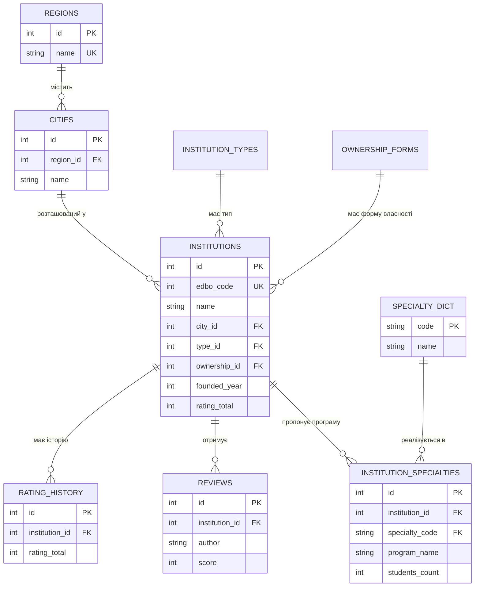

# Проєкт «Освітній простір України» — дисципліна «Бази даних»

Предметна область: заклади освіти України (реєстр ЄДЕБО) та їх рейтинги (vstup.osvita.ua).
СКБД: **PostgreSQL**. Мова додатку: **Python** (парсери + FastAPI). Усі теми силабусу реалізовані
в `db/sql/*.sql` — по одному файлу на тему/групу тем. Нумерація файлів = порядок виконання.

## Відповідність силабусу

| № | Тема заняття | Де реалізовано | Що показати |
|---|---|---|---|
| 1 | Вступ до теорії БД | цей документ, розділ 1 | ЄДЕБО → БД, СКБД, моделі даних |
| 2 | Предметна область і її моделі | розділ 1–2 цього документа | опис сутностей, ER-діаграма |
| 3 | Модель «Сутність–зв'язок» | розділ 2 (ER-діаграма) + таблиці в `00`, `01`, `02` | зв'язки 1:M, M:N (через `institution_specialties`) |
| 4 | Реляційні БД, перехід ER → таблиці, базисні засоби маніпулювання | `01_normalization.sql`, **`04_relational_algebra.sql`** | σ π ∪ ∩ − × ⋈ ÷ у SQL; PK/FK/UNIQUE/CHECK |
| 5 | Функціональні залежності, декомпозиція без втрат | **`01_normalization.sql`** | аналіз FD в коментарі, перевірка `lossless_join_check` (0 втрат) |
| 6 | СКБД, мова SQL, складові | `00`–`03`, цей документ | DDL / DML / DQL / DCL / TCL у PostgreSQL |
| 7 | DDL, DML, DQL | **`02_ddl.sql`**, **`03_dml.sql`**, **`05_dql_queries.sql`** | CREATE/ALTER/DROP/TRUNCATE; INSERT/UPDATE/DELETE/UPSERT; 15 запитів (JOIN, CTE, вікна) |
| 8 | Представлення | **`06_views.sql`** | звичайні, `WITH CHECK OPTION`, матеріалізоване, INSTEAD OF |
| 9 | Змінні, тимчасові таблиці, індекси | **`07_temp_tables_indexes.sql`** | DECLARE / set_config, TEMP TABLE, B-tree, GIN+trigram, часткові, EXPLAIN |
| 10 | Вбудовані функції | **`08_builtin_functions.sql`** | рядкові, числові, дата/час, агрегатні, умовні, JSON |
| 11 | Процедури та функції користувача | **`09_functions_procedures.sql`** | 7 функцій, 6 процедур (INOUT, винятки, COMMIT всередині) |
| 12 | Тригери | **`10_triggers.sql`** | BEFORE/AFTER/INSTEAD OF, ROW/STATEMENT, WHEN, 9 тригерів |
| 13 | Адміністрування, DCL | **`11_dcl_roles.sql`** | ролі, GRANT/REVOKE, права на стовпці, Row-Level Security |
| 14 | Команди адміністрування, події | **`12_admin_events.sql`**, `db/events.py`, `db/backup.py` | VACUUM/ANALYZE, pg_stat_*, EVENT TRIGGER, LISTEN/NOTIFY, планувальник, pg_dump |
| 15 | Керування транзакціями | **`13_transactions.sql`**, `db/demo_transactions.py` | COMMIT/ROLLBACK/SAVEPOINT, ізоляція, блокування, deadlock |

> У силабусі приклади з **MySQL**. Усі поняття еквівалентні; відмінності: у PostgreSQL немає `CREATE EVENT`
> (замінено на event trigger + LISTEN/NOTIFY + планувальник), `GROUP_CONCAT` → `string_agg`,
> `IFNULL` → `COALESCE`, `ON DUPLICATE KEY UPDATE` → `ON CONFLICT DO UPDATE`, `START TRANSACTION` → `BEGIN`.

## 1. Теорія (теми 1–2)

**База даних** — упорядкована сукупність взаємопов'язаних даних предметної області, що зберігається
й обробляється СКБД. **СКБД** (тут PostgreSQL) забезпечує зберігання, цілісність, багатокористувацький
доступ, безпеку, транзакційність. Моделі даних: ієрархічна, мережева, **реляційна** (обрана: дані у
вигляді відношень-таблиць, математична основа — реляційна алгебра), документна/графова (NoSQL).

**Предметна область:** держава має мережу закладів освіти. Кожен заклад має код ЄДЕБО, назву, тип
(ЗВО, коледж, ліцей…), форму власності, розташований у населеному пункті певної області, пропонує
освітні програми за спеціальностями (з акредитацією та кількістю студентів), має рейтинг, що змінюється
з часом, і відгуки користувачів.

**Потоки даних:** `parser/test.py` (ЄДЕБО) → `institutions`, `institution_specialties`;
`parser/raiting.py` → рейтинг; `web/app.py` → REST API; усе «розумне» (валідація, аудит, агрегати) — в самій БД.

## 2. ER-модель (тема 3)



Допоміжні таблиці: `audit_log` (аудит), `maintenance_log` (службові задачі), `ddl_log` (DDL-події) — без зв'язків.

* **Сутності:** Заклад, Область, Місто, Тип, Форма власності, Спеціальність, Відгук, Запис історії рейтингу.
* **Зв'язки 1:M:** Область→Місто→Заклад, Тип→Заклад, Заклад→Відгук, Заклад→Історія.
* **Зв'язок M:N:** Заклад ↔ Спеціальність; розв'язується асоціативною таблицею `institution_specialties`
  (вона ж містить атрибути зв'язку: програма, рівень, акредитація, студенти).

**Правила переходу ER → реляційна модель:** сутність → таблиця; ідентифікатор → PRIMARY KEY; зв'язок 1:M →
FOREIGN KEY на стороні «багато»; зв'язок M:N → окрема таблиця з двома FK; атрибути зв'язку → стовпці цієї таблиці.

## 3. Нормалізація (тема 5)

| Було | Порушення | Рішення |
|---|---|---|
| `institutions.city → region` | транзитивна залежність (3НФ) | таблиці `regions`, `cities` |
| `institutions.type`, `ownership` | повтор значень, аномалії оновлення | `institution_types`, `ownership_forms` |
| `institution_specialties.specialty_code → specialty_name` | часткова залежність (2НФ) | таблиця `specialty_dict` |
| `institutions.rating_*` | «знімок» без історії | `rating_history` + тригер |

Декомпозиція **без втрат** підтверджена запитом у кінці `01_normalization.sql`: з'єднання частин відновлює
початкову таблицю, `lost_rows = 0`, `spurious_rows = 0`.

*Свідомий компроміс:* текстові стовпці `region/city/type/ownership` в `institutions` залишено, бо в них пишуть
парсери. Їх синхронізує тригер `trg_institutions_01_normalize`; за бажання їх можна видалити (`ALTER TABLE ... DROP COLUMN`)
і змінити парсер, щоб він писав `city_id` напряму.

## 4. Запуск

```bash
pip install -r requirements.txt
cp .env.example .env            # вкажіть доступ до PostgreSQL
python db/run_sql.py --quiet    # встановити/оновити ВСЕ (скрипти ідемпотентні, можна запускати повторно)
python db/run_sql.py 99 --quiet # (лише якщо БД порожня) тестові дані
python db/run_sql.py 05         # показати будь-яку тему з результатами: номер файлу
cd web && uvicorn app:app --reload      # API + Swagger на http://localhost:8000/docs
```

**ВАЖЛИВО:** перед першим запуском на реальній БД зробіть копію: `python db/backup.py dump`.

## 5. План захисту (≈10 хвилин)

1. **ER + нормалізація:** цей документ → `python db/run_sql.py 01` (lossless join = 0 втрат).
2. **Реляційна алгебра, SQL:** `run_sql.py 04`, `run_sql.py 05` (покажіть ÷ ділення та віконні функції).
3. **Представлення, індекси:** `run_sql.py 06`, `run_sql.py 07` (EXPLAIN з GIN-індексом).
4. **Функції/процедури/тригери:** `run_sql.py 09`, `run_sql.py 10` — у демо «Демо 1–4» видно роботу тригерів.
   Потім у Swagger (`/docs`): `POST /api/institutions/{id}/reviews` → `GET .../card` (агрегат оновився тригером).
5. **Ролі:** `run_sql.py 11` (SET ROLE role_guest, RLS бачить лише схвалені відгуки).
6. **Події:** термінал 1 `python db/events.py listen`, термінал 2 — додайте відгук у Swagger → з'явиться подія.
7. **Транзакції:** `python db/demo_transactions.py` (rollback, non-repeatable read, lock, deadlock).

## 6. Що змінено відносно початкового проєкту

* `parser/*` — **без змін** (працюють через тригери).
* `web/app.py` — пошук тепер викликає `fn_search_institutions`; нові ендпоінти: відгуки, рейтинг та його історія,
  статистика, аудит, адмін-інформація; помилки БД (`RAISE EXCEPTION`) перетворюються на HTTP 404/409/400.
* Нове: `db/` (SQL-скрипти, `run_sql.py`, `events.py`, `backup.py`, `demo_transactions.py`).

## 7. Відомі особливості

* Парсер записує `str(NaN)` як рядок `'nan'` — тригер і `fn_clean_text` перетворюють його на NULL.
* `GET /api/top` сортує за `rating_total` за зростанням (як було в початковому коді) — перевірте, чи це потрібний порядок.
* Паролі користувачів у `11_dcl_roles.sql` — навчальні (`change_me_*`), змініть їх.
* Скрипти перевірені на PostgreSQL 16 (потрібна версія 11+). `CREATE EVENT TRIGGER` та `CREATE ROLE` потребують прав
  суперкористувача/CREATEROLE; без них відповідні оператори виведуть повідомлення, решта працює.
